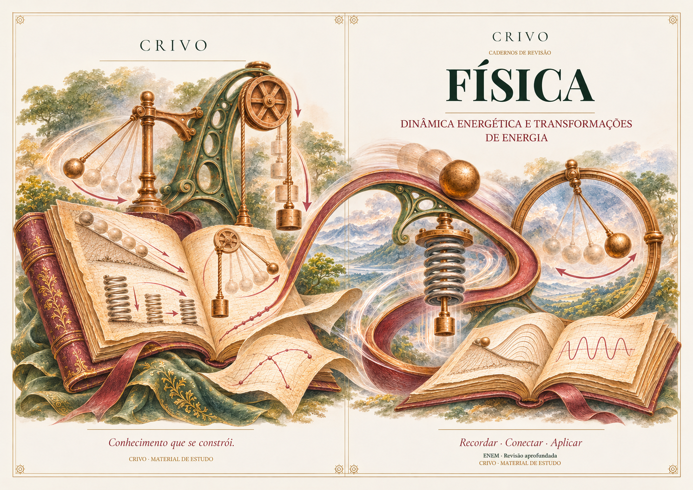
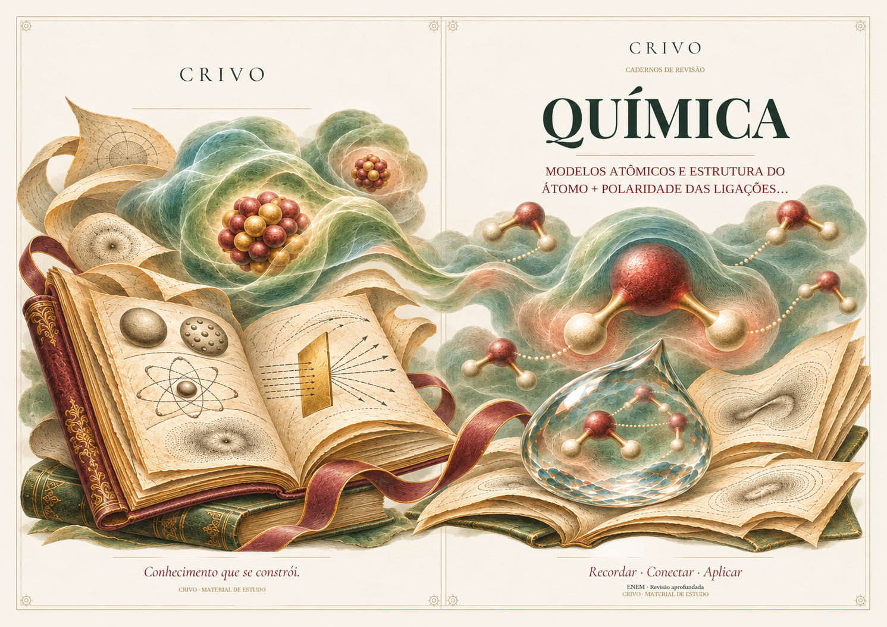
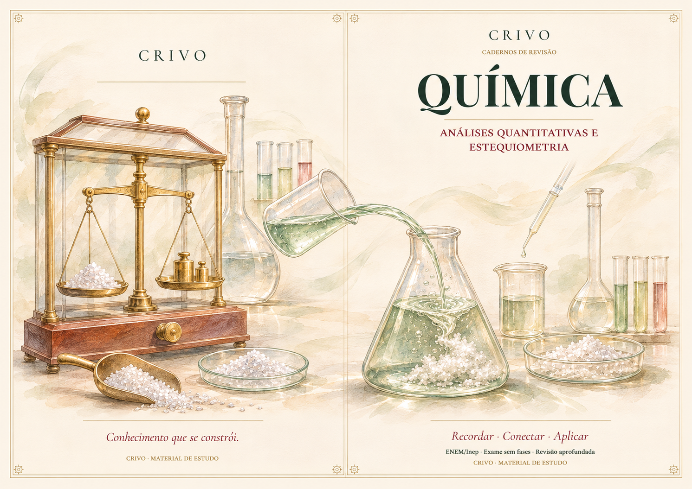

# Capas vivas e integradas à página

A direção abaixo foi aprovada em 09/11/2026 para **todas as matérias**, em
revisões e aprofundamentos. Substitui a interpretação de ilustração pequena,
estática ou com amplos espaços laterais. Física e Química são referências de
acabamento e composição; seus objetos não devem ser transferidos a outros temas.

## Referências aprovadas

### Refinamento aprovado: presença com leveza

O refinamento posterior mantém os protagonistas grandes e o movimento, com
aquarelas quase transparentes e gravuras finas integrando as margens. A cena
conserva ar entre os elementos; ocupar a largura útil não significa empilhar
objetos ou criar blocos densos de cor. A conexão continua pertencendo ao tema:
neste exemplo, o fluxo de solução atravessa a dobra e liga os dois lados.
As reservas de tipografia e rodapé seguem transparentes no pedido de arte.

### Cor viva e conferência pelo fluxo real

O ajuste posterior exige pigmentos mais vivos nos protagonistas: verde nítido
e profundo, vinho distinto de marrom, cobre e dourado quentes e cores próprias
do conteúdo preservadas. Sépia orienta a gravura, não um filtro sobre toda a
pintura. Transparência leve fica nas margens; objetos sólidos mantêm cor
definida, respeitando materiais naturalmente translúcidos como vidro e líquido.
A leveza vem do espaço e das transições, sem apagar os pigmentos nem usar néon.

Para conferir correspondência com o aplicativo, gerar pela rota autenticada
real `/api/cover-illustrations` e montar a resposta no compositor nativo. Uma
prévia criada em outra ferramenta continua sendo referência visual e não
comprova, sozinha, a saída do provedor ativo. Não mudar endereço, credenciais,
quota ou transporte apenas para produzir uma prévia diferente.

As imagens são exemplos autorais gerados para aprovação, sem dados pessoais.
Não são capas fixas usadas no aplicativo nem PDFs de estudo da estudante.

## Regras do motor

- Gravura fina e aquarela naturalista, verde profundo, vinho, cobre e dourado
  contidos. Protagonistas grandes, profundidade e detalhes entrelaçados.
- A cena mostra uma relação se desenvolvendo. Movimento físico só onde fizer
  sentido; em Linguagens e Humanas, desenvolvimento textual, narrativo ou social.
  Não acrescentar máquinas, plantas, fumaça ou figuras alegóricas genéricas.
- A composição ocupa a largura útil até perto da moldura. Elementos e lavagens
  são redistribuídos de forma orgânica; não esticar objetos nem preencher a
  página com uma faixa horizontal.
- As margens recebem transições quase transparentes e detalhes pertinentes,
  com leveza. Evitar fundos densos, sombreamento escuro, folhagens ou objetos
  extras usados apenas para preencher espaço. Aquarela não substitui a conexão.
- Capa e contracapa têm protagonistas diferentes e complementares, ligados por
  um elemento contínuo do próprio recorte, que toca ambas as cenas e atravessa
  a dobra na mesma posição e escala. Paleta compartilhada não substitui a conexão.
- O subtópico específico prevalece. Modelos atômicos históricos conservam suas
  estruturas; temas elétricos/térmicos não herdam o inventário de mecânica.
- Entrega de capa aberta em uma página A4 paisagem, contracapa à esquerda e
  capa à direita; moldura, títulos e rodapés continuam nativos do aplicativo.

## Geração e montagem

`coverArtDirection.ts` compartilha o acabamento entre frente, verso e livreto.
`coverPairVisualBrief.ts` escolhe cenas e conexão pelo recorte. O fluxo continua
pedindo uma arte personalizada por edição, sem trocar provedor ou autenticação.

`bookletCoverLayout.ts` compartilha as reservas entre prompt e compositor:
topo esquerdo de 20%, topo direito de 34% e base de 16%; a conexão atravessa a
dobra entre 40% e 55% da altura. O arquivo gerado representa a folha inteira.

Quando os pixels úteis de uma saída transparente ultrapassam as reservas, o
compositor calcula o maior encaixe único que respeita os dois lados. A arte
correta mantém escala integral. A adaptação preserva o eixo da dobra e usa a
mesma escala nas duas direções, sem redimensionar as cenas separadamente.
Lavagens quase invisíveis não devem reduzir os protagonistas. Uma camada sem
alfa útil conserva o enquadramento e usa o recorte nativo de proteção do texto.

As referências completas acima incluem tipografia na imagem apenas como
exemplos visuais. O motor pede somente a arte transparente e mantém texto
pesquisável, fontes incorporadas e ornamentos vetoriais no PDF.

## Validação e limites

Testes verificam as instruções enviadas para 13 matérias nos três formatos,
prioridade de recorte, conexão obrigatória, encaixe máximo, proteção dos títulos
e rodapés e pixels atravessando a dobra, além da preservação de fontes e miolo.
As prévias de Física e Química foram geradas pela ferramenta de imagem com o
texto do motor e montadas pelo compositor real; não foram chamadas ao provedor
de produção. Essa inspeção revelou e corrigiu cortes de objetos que um recorte
rígido causava quando o gerador não respeitava as reservas.

A aprovação das referências não certifica toda futura saída de geração.
PDFs salvos permanecem intactos; a nova direção orienta as novas edições após
integração e publicação. Código mesclado e implantação são estados distintos.
