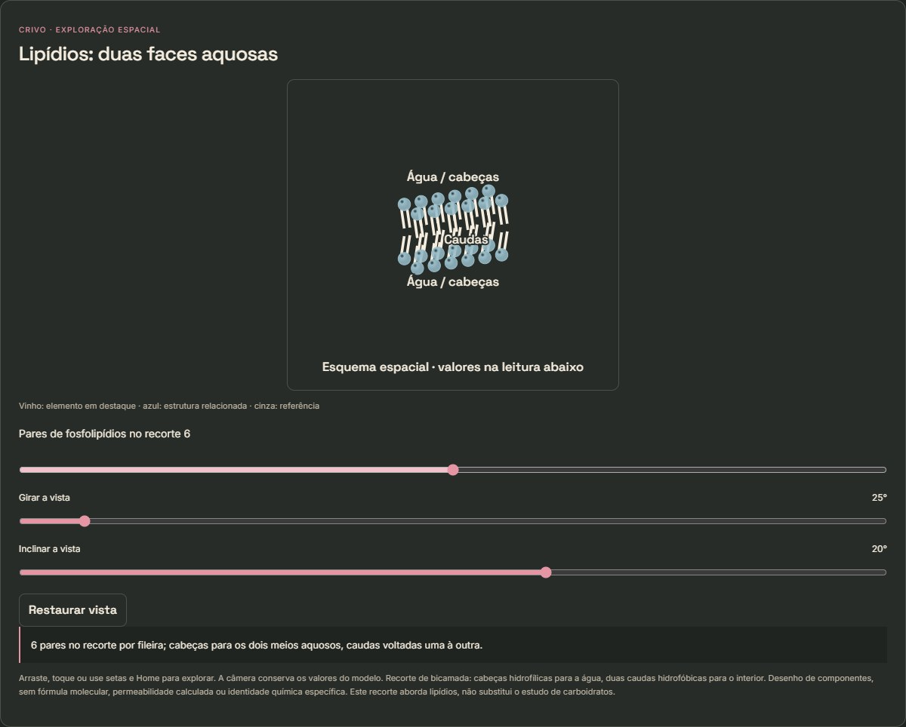
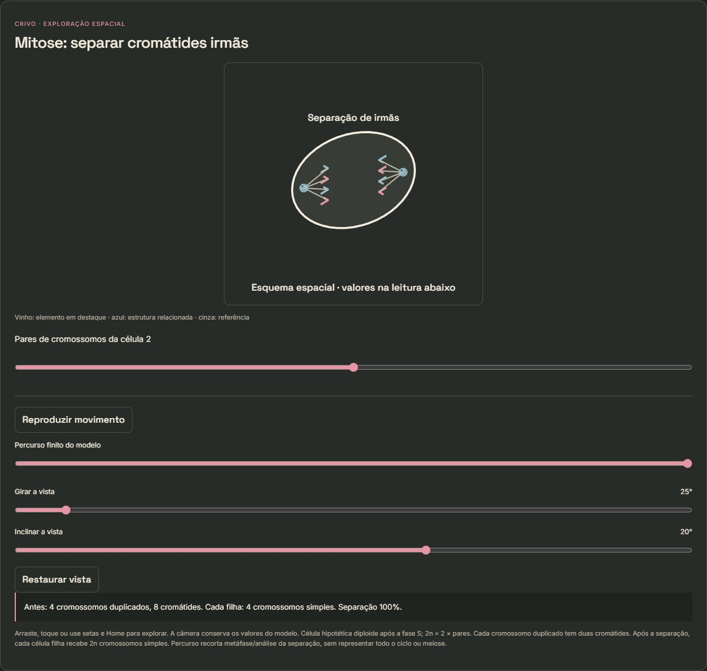
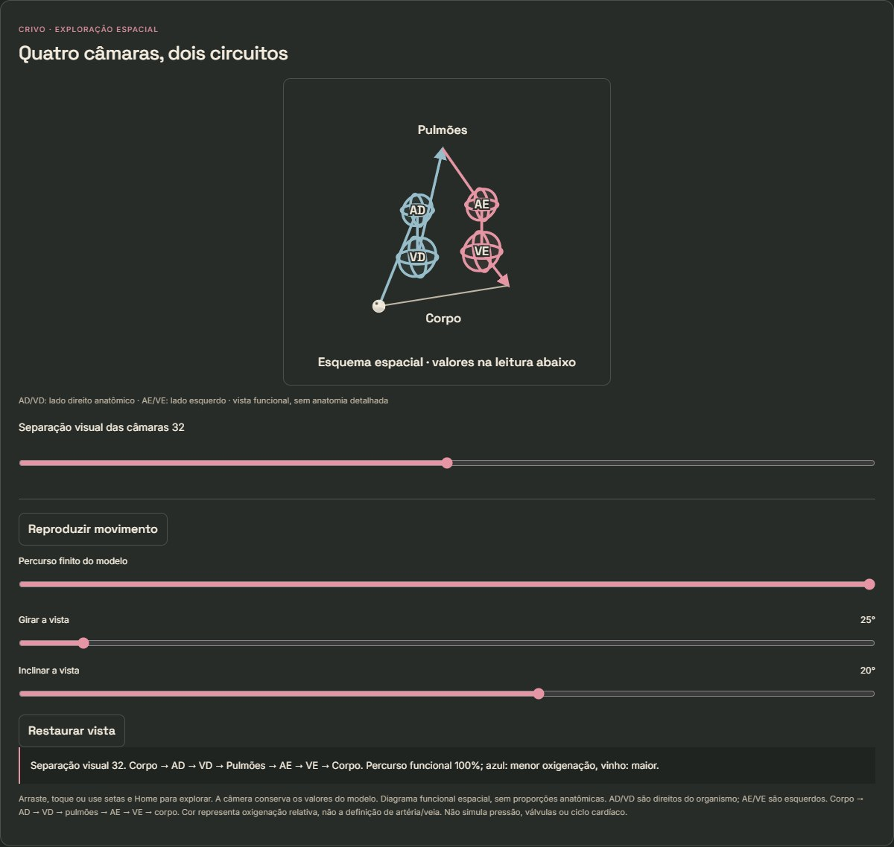
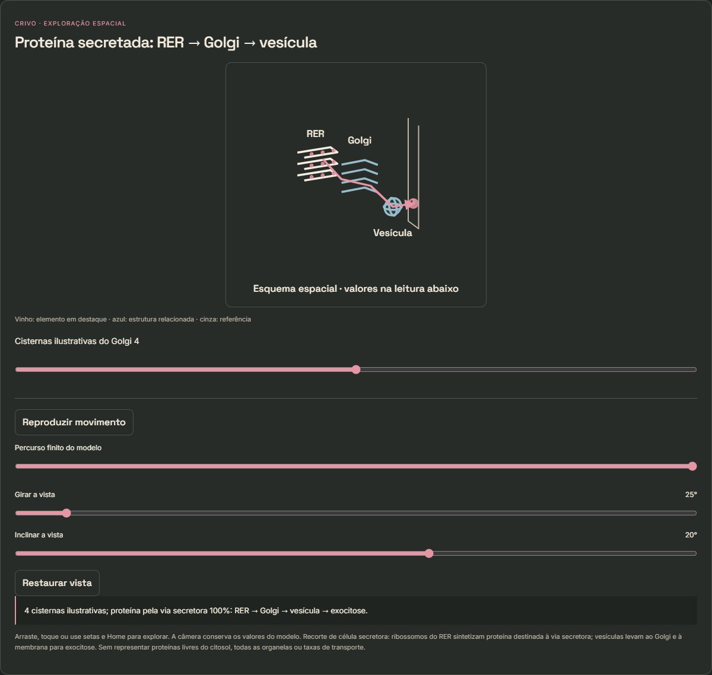
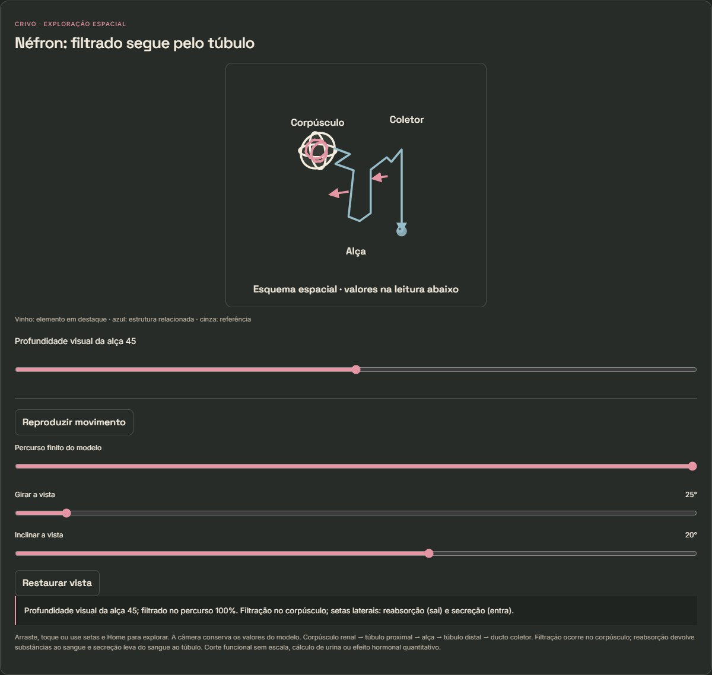
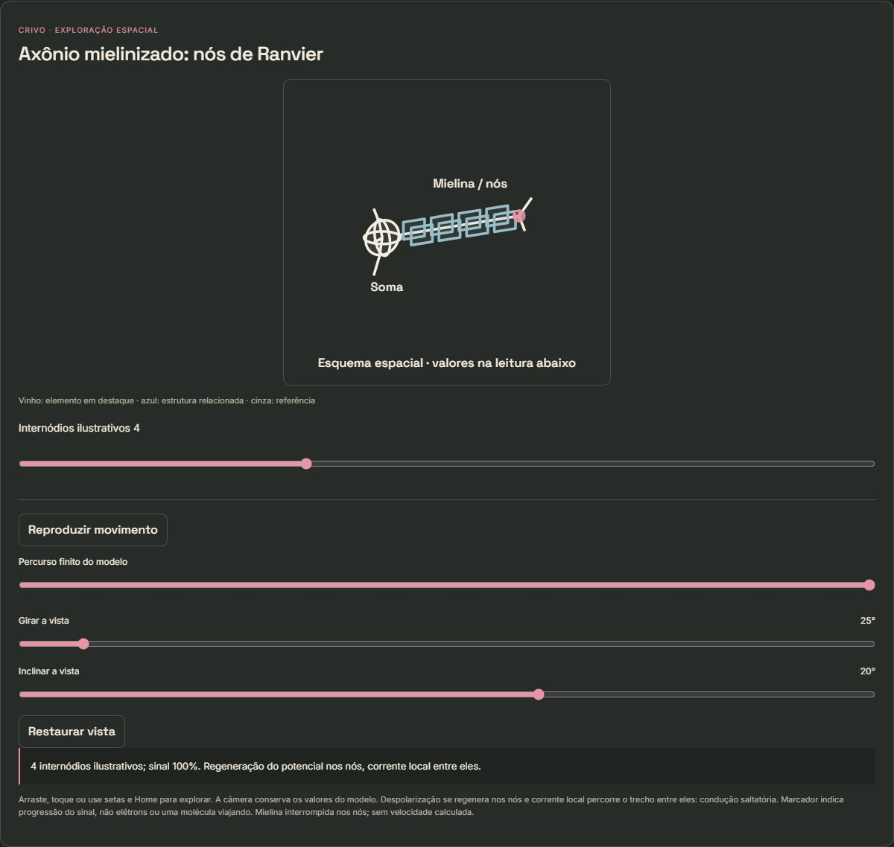
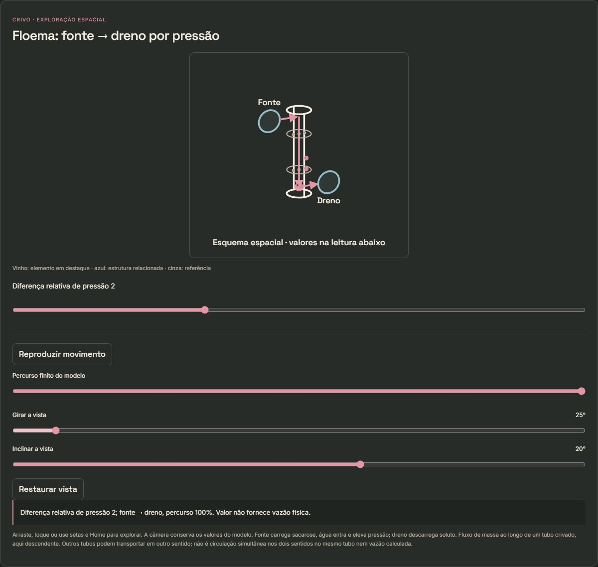
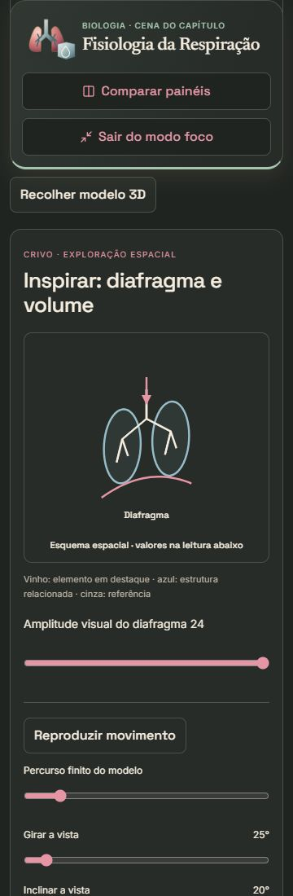
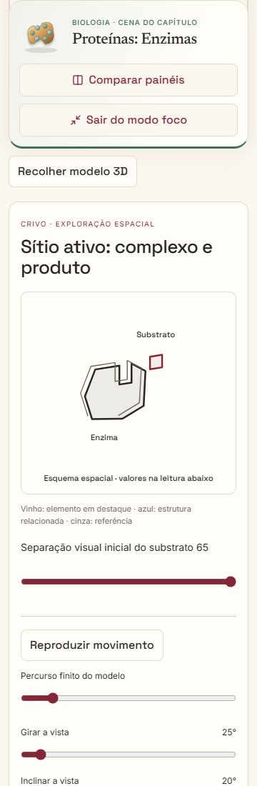
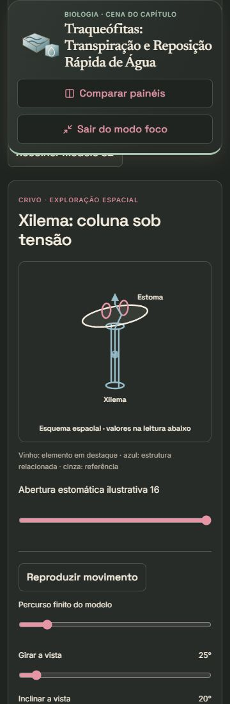

# Galeria dos modelos de Biologia

Doze exemplos do build 36f987fa5b26085753a7ededa537903127fa9e51f838f7330b9f67edd4e4b40c. Configurações completas em capturas.json. A galeria não equivale à aprovação pedagógica.

## Composição Química Celular: Carboidratos e Lipídios

## Composição Química Celular: Proteínas e sua Função Estrutural

## Divisão Celular

## Coração e Vasos Sanguíneos

## Citoplasma: Estrutura e Componentes I

## Fisiologia da Excreção

## Fisiologia da Coordenação Nervosa I

## Fisiologia Vegetal: Transporte no Floema

## Alelos Múltiplos e Herança dos Grupos Sanguíneos

## Fisiologia da Respiração

## Proteínas: Enzimas

## Traqueófitas: Transpiração e Reposição Rápida de Água

